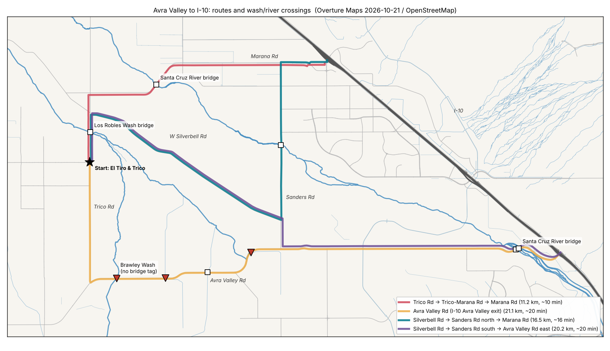

> Current 2D draft requirements and completion status: [2D-DRAFT-CHECKLIST.md](2D-DRAFT-CHECKLIST.md). Earlier scope/completion language below does not override that checklist. Full SFINCS + HAND + Combined and current coarse model refresh are required; 3D/refinement are separate.

# FLOODplain: scope

## Context
This is a personal tool for one person, and maybe their family: before leaving for work, check whether water is over the roads on the commute. Existing city tools only show closures, and they show them after the fact. The aim is to see water levels early and, if needed, add a few homemade sensors at low spots. It's a free public service: no money, no organization, no ongoing hosting bill.

## 1. Existing tools (use these first)
- **USGS WaterAlert** (free email/text when a stream gauge passes a level you pick). If a gauge sits near your trouble spot, this alone may solve the commute problem today, with no build.
- **USGS gauges** (stream height every 15 min) and **NWS gauges** (water.noaa.gov), which carry official flood stages (action/minor/moderate/major) and forecasts. The map pulls both.
- **FEMA flood zones**: a map overlay showing where flooding is expected.
- **Open designs to copy for hardware:** NYC's **FloodNet** is an open-source ultrasonic street-flood sensor, the same idea as yours, already proven. I'll base the build on it instead of inventing one.
- Many states and counties run their own flood-warning gauge networks (e.g. NC FIMAN, Harris County TX, Iowa IFIS). Once I know your city, I'll check whether yours has one and add it as a map layer.

## 2. Legality (plain version; general US info, not legal advice)
- **Your own property, or a friend's or family member's with their OK:** fine. Get the OK in writing, even a text.
- **City/county/state poles, bridges, guardrails, signs:** someone else owns them. Attaching without asking is encroachment, and they can remove it. Asking costs one email to public works or stormwater ("I'm a resident, I want to put a small battery water sensor here, it's free, you can have the data"). Many cities say yes. **Never** attach anything to traffic signals or signs.
- **Inside a creek or ditch channel:** don't put a new post in the water without checking. That can trigger state or federal waterway permits. Mounting on an existing structure *above* the water avoids this.
- **Radio:** WiFi and LoRa (915 MHz) are license-free with off-the-shelf certified modules.
- **Sharing with family or the public:** the map shows a clear "Turn Around, Don't Drown. This is a hobby sensor, not an official warning" banner.

## 3. Real-world constraints at a road low spot
- **Power:** battery plus a small solar panel. The ESP32 wakes, measures, sends, and sleeps.
- **Connectivity is the hard part.** WiFi only works if a willing neighbor's network reaches the spot. Otherwise LoRa needs a gateway (around $100 one-time, or free if The Things Network already covers the area). Cellular means a monthly fee, so it's out.
- **Cost:** about $50–70 per sensor (ESP32, JSN-SR04T waterproof ultrasonic sensor, enclosure, 18650 battery, 1W solar panel).

## 4. What gets built (pilot: 1–5 sensors)
- `public/index.html`, `public/app.js`, `public/style.css`: a static Leaflet map hosted free on **GitHub Pages**. Layers:
  - USGS and NWS gauges, colored by flood category, with rising/falling arrows. The browser calls the public APIs directly; the parsing logic is ported from `server/upstream.js`.
  - FEMA flood-zone overlay.
  - Your sensors.
  - **"My route"**: save home and work, and see the gauges and sensors near the route at a glance.
- Sensor data goes to **ThingSpeak's free tier**. It's non-commercial and allows one reading per 15 s, which is plenty. The map reads each public channel's JSON. Depth math from `server/levels.js`: `depth = baseline − distance`, plus warn/danger thresholds.
- `hardware/esp32-water-level/`: an Arduino sketch (deep sleep, a median of several pings, WiFi to ThingSpeak, with LoRa as a later option). The README covers parts, mounting, calibration, and the permission email template from section 2.
- `docs/SCOPE.md`: sections 1–3 above, so the reasoning lives in the repo.
- Delete `server/`, the SQLite code, and the `leaflet` npm dependency (Leaflet loads from a CDN on Pages).

## Local: Avra Valley (unincorporated Pima County, AZ)
Avra Valley has a Marana mailing address, but it is mostly **unincorporated Pima County**. Pima County, not the Town of Marana, generally owns the roads and the flood data. The Town only comes in near I-10.

### Hazard pattern
- **Monsoon (Jul–Sep) and winter storms cause flash floods.** Washes go from dry to impassable in minutes, so **upstream rain gauges give the earliest warning**.
- **Brawley Wash** drains most of Avra Valley; **Blanco Wash** drains the west side. Both flow north into the **Santa Cruz River**, which every route east to I-10 has to cross.
- **Crossings named repeatedly in closures and NWS warnings** (dates vary, so this needs confirming):
  - Avra Valley Rd at Brawley Wash, and at Trico Rd and El Paso Gas Rd
  - Sandario Rd between Twin Peaks and Avra Valley Rd
  - Twin Peaks Rd near Sandario
  - Manville Rd and Sasco Rd low-water crossings
- **The Avra Valley Rd bridge over the Santa Cruz** has been closed before, which stranded residents. This is the single biggest choke point.

### Existing infrastructure and tools
| What | Who | Use for this project |
|---|---|---|
| ALERT network: 100–150 rain/stream/weather stations, 10-min to 30-day rain totals ([map](https://alertmap.rfcd.pima.gov/Gmap/Gmap.html)) | Pima County Regional Flood Control District | **Main data source.** Find which stations sit upstream of each crossing. A data feed has not been confirmed yet (PAG also hosts an `RN_ALERT` ArcGIS layer). |
| MyAlerts ([myalerts.pima.gov](https://myalerts.pima.gov)): text/call/email flood alerts for addresses inside a mapped inundation area | Pima County OEM + RFCD | **Sign up today.** Enter the home and work addresses to find out whether they're covered. |
| USGS 09486509: Santa Cruz River at Avra Valley Rd | USGS | Right at the main choke point. Map layer, plus a free WaterAlert text. |
| USGS 09486515 (Sanders Rd), 09486520 (Trico Rd) | USGS | Santa Cruz upstream and downstream of the crossings. |
| USGS 09487000: Brawley Wash near Three Points | USGS | Far upstream (south) of the valley, so an early signal for Brawley Wash. |
| NWS Tucson flash-flood warnings (they name specific crossings) | NWS | Map layer and banner. |
| Pima County road closures (pima.gov/898); Marana PD/Town posts near I-10; AZ 511 for I-10 | County / Town / ADOT | Closures, which the map links to rather than duplicates. |

### Limitations of the public tooling (researched Oct 31, 2026)
| Tool | Limitation | What it means for us |
|---|---|---|
| **Pima ALERT** | No documented API, bulk export, or terms for programmatic use. The public map runs on undocumented internal endpoints (e.g. `dss_stream.php?id=`). Data is provisional and unverified. | Ask RFCD for a feed and permission before building on it. Until then, link out to the map and don't scrape. Station IDs near the routes are still unconfirmed. |
| **MyAlerts** | Only covers addresses inside mapped inundation areas of certain watersheds. Alerts describe the wash, not road status. | It may cover home, but not the crossings you drive. Useful as a supplement only. |
| **USGS WaterServices** (legacy `waterservices.usgs.gov`) | Being degraded starting Nov 2026; shuts down **Feb 22, 2027**. | Build only on `api.waterdata.usgs.gov` (new OGC API). It needs a free API key beyond a few requests/hour. |
| **USGS gauges here** | Desert washes read near zero most of the year. A river stage reading isn't water depth on a road. The parameters for 09486509 (Avra Valley Rd) are unconfirmed. | Gauges show whether a river is rising, not whether a dip is passable. Confirm each site reports gage height in real time. |
| **USGS WaterAlert** | Subscriptions now expire (feature added May 2026). | Renew them, or a silent expiry looks like "no flooding". |
| **NWS NWPS** | Only 2 forecast points nearby: CSCA3 (Santa Cruz at Cortaro, flood stage 18.5 ft) and BWTA3 (Brawley Wash near Three Points). Flood stages are for the river, not road crossings. | No official forecast exists at any Avra Valley dip. |
| **Road closures** | Pima County posts closures on a web page (pima.gov/898); no data feed was found. AZ511 has an API (free key, 10 calls/min), but it mainly covers state highways like I-10. Closures go up after flooding starts. | Link out to closures rather than ingest them. Use AZ511 only for I-10. |
| **ThingSpeak free tier** | 3M messages/yr, 15 s minimum interval, **4 channels**, non-commercial only. | Fine for a pilot of up to 4 sensors on one account. |
| **This dev environment** | Its network blocks pima.gov, USGS, and NOAA. | Live API checks have to happen from your machine or GitHub Pages, or after those hosts are allowed. |

**Bottom line:** no public tool reports real-time water depth at a specific county dip. The public data can only say "rain upstream" and "river rising". The homemade sensors are what fill that gap.

### Where homemade sensors add value
There's a gap between "rain fell upstream" (ALERT) and "the road is closed" (a barricade goes up). Nobody publishes **water depth at the specific dips on these routes**. A sensor on a post beside a crossing, **on a willing neighbor's land** with no right-of-way permit needed, fills that gap.

## Routes east to I-10 (computed, not guessed)

Routed on OpenStreetMap road geometry via **Overture Maps release 2026-10-21.0**, using the scripts in `tools/` (fetch → road graph → Dijkstra → route ∩ waterways). Every route starts at the shared **W El Tiro Rd & N Trico Rd** junction, because this repo is public and no home address goes in it. Output: `public/data/routes.geojson`, `public/data/crossings.geojson`.

| Route | Distance / free-flow time | Water crossings | Gauge at the crossing |
|---|---|---|---|
| Trico Rd → Trico-Marana Rd → Marana Rd | 11.2 km / ~10 min | Los Robles Wash (bridge, on Trico Rd); **Santa Cruz (Trico-Marana bridge)** | USGS 09486520, Santa Cruz at Trico Rd |
| Avra Valley Rd → I-10 Avra Valley exit | 21.1 km / ~20 min | **Brawley Wash** plus 2 unnamed washes with **no bridge tag** (likely dips); 1 bridged wash; **Santa Cruz (Avra Valley Rd bridge)** | USGS 09486509, Santa Cruz at Avra Valley Rd |
| **Silverbell → Sanders Rd north → Marana Rd** | 16.5 km / ~16 min | Los Robles Wash (bridge, on Trico Rd); **Santa Cruz (Sanders Rd bridge)** | USGS 09486515, Santa Cruz at Sanders Rd |
| Silverbell → Sanders Rd south → Avra Valley Rd east | 20.2 km / ~20 min | Los Robles Wash (bridge); Santa Cruz (Avra Valley Rd bridge) | USGS 09486509 |

### What the routing shows about Silverbell
- West of Sanders Rd, **W Silverbell Rd runs between the Los Robles/Brawley wash system and the Santa Cruz. It crosses no mapped wash** between Trico Rd and Sanders Rd.
- **Silverbell → Sanders south** joins Avra Valley Rd east of the Brawley Wash crossing and the 2 untagged dips, so it skips them. It still uses the Avra Valley Rd Santa Cruz bridge.
- **Silverbell → Sanders north** avoids Avra Valley Rd entirely and crosses the Santa Cruz on the **Sanders Rd bridge** instead (built 1975, rated satisfactory, ~3,300 vehicles/day). No report was found of it closing for flooding. However, one past storm closed *all* Northwest Side Santa Cruz bridges for hours, and Trico-Marana stayed closed the longest.
- Every route still crosses the Santa Cruz once, and **each Santa Cruz crossing has its own USGS gauge**. That gives one gauge per route for the river.
- **Local knowledge:** W Silverbell is paved. It sometimes washes out from poor road drainage with no clear dip, but never deep enough to be life-threatening.
- **Unconfirmed:**
  - News lists past Silverbell closures (Blanco Wash crossing, Avra Valley Rd to Sasco Rd), but those appear to be other stretches.

### Data limitations of the routing
- **OSM wash coverage is incomplete.** Only a handful of the washes are named, and small washes may be missing entirely. A dip on a mapped road can go undetected if its wash isn't mapped.
- "No bridge tag" ≠ "dip". OSM may just lack the tag (bridge inventories list an Avra Valley Rd bridge over the *E Branch* of Brawley Wash). Each one needs a visual check.
- Travel times are free-flow estimates from road class, not traffic.

## Open item
Verify the 3 untagged Avra Valley Rd crossings and Silverbell pavement on the ground. Match each crossing to its upstream ALERT rain gauges.
