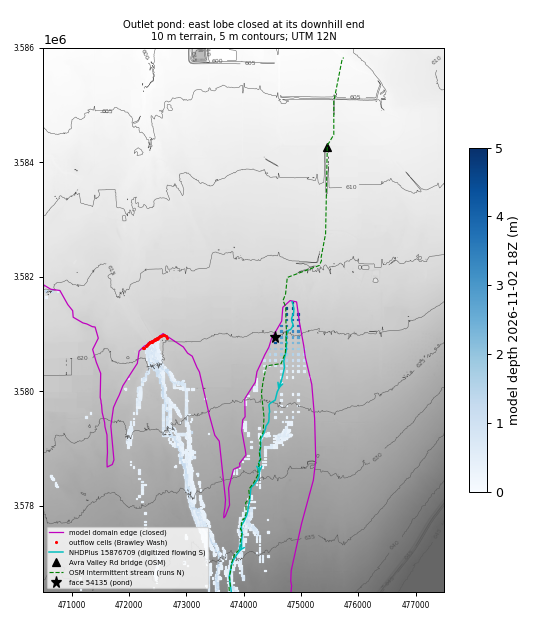

# Brawley-avra-west: terrain check of the outlet pond (v2x run 42544624673)

Date: 2026-11-08. Checks only: nothing was rebuilt and the solver was not run.

## Verdict

**It is an artifact, but not a terrain artifact.** The terrain is fine. The model domain is closed at the downhill end of a side lobe, and that end has no outflow cells. In reality the ground keeps falling to the north and the water would leave the domain there.

- The pond sits at the north tip of a narrow domain lobe, about 2 km east of the Brawley Wash outflow cells. The lobe follows NHDPlus flowline 15876709.
- **NHDPlus has this line backwards.** It is digitized as a headwater (startflag 1) that flows 6.4 km **south**, joining Brawley Wash at node 720009587. The 10 m terrain along the line does the opposite: it is 641.15 m at the "downstream" (south) end and 617.76 m at the "upstream" (north) end. That is 23.4 m of fall to the north, about 3.7 m/km.
- The domain is the union of NHDPlus catchments, and outflow points are placed only where a directed NHD river leaves the domain. So the north tip of this catchment was treated as a divide, a closed edge with no outflow. In the 10 m terrain it is not a divide.
  - The ground keeps falling north past the edge: 618.0 m at y 3581500, 616.2 at 3582000, 612.4 at 3583000, 605.0 at 3585000 (x 474600, 30 m-box minimum).
- So every drop that enters the lobe ends up stored against the closed edge.

## What the model does there

**Pond cell.** Face 54135 is at UTM 32612 (474550, 3580950), about −111.2705, 32.3652.
- It is refinement level 1, a 100 m cell, 41 m inside the domain edge.
- Subgrid table (v2 parameters; identical to the run's `sfincs_subgrid.nc`):

  | Field | Value |
  |---|---|
  | z_zmin | 617.08 |
  | z_zmax | 620.43 |
  | z_volmax | 5,291 m³ |
  | z_level | 617.08, 618.52, 619.23, 619.80, 620.07, 620.17, 620.25, 620.31, 620.37, 620.43 |

- The 5.62 m depth is measured from z_zmin, the lowest sub-pixel. The volume table puts the mean bed of the cell near 619.9 m, so the cell-average depth at 18Z is about 2.8 m.
- A small intermittent NHD water body (stock tank, com_id 126477925) lies 110 m away and explains the low sub-pixel.

**Neighbours.**
- The 12 nearest cells have z_zmin 618.4–620.8 and z_zmax 619.7–621.3. All are level 1 (100 m).
- Within 1.5 km there are 127 cells at level 1, 175 at level 2 and 109 at level 3. There are no level 4/5 cells.
- At 18Z all 13 cells share one flat water surface, **zs 622.70**: a lake, not a single-cell pit.

**The lake fills steadily.** The lobe is the domain east of x 473600 and north of y 3578000, 3,049 cells. Its stored volume:

| Time (UTC) | Lobe volume (m³) | Pond zs (m) |
|---|---|---|
| Nov 1 21Z | 19,817 | 618.72 |
| Nov 2 03Z | 50,781 | 619.97 |
| Nov 2 07Z | 227,843 | 620.23 |
| Nov 2 11Z | 489,338 | 620.92 |
| Nov 2 13Z | 734,410 | 621.52 |
| Nov 2 15Z | 997,900 | 622.11 |
| Nov 2 17Z | 1,218,902 | 622.53 |
| Nov 2 18Z | 1,317,457 | 622.70 |

- Within 1.5 km of face 54135 the stored volume is 1,241,386 m³ at 18Z.
- The lobe gains storage fastest between 12Z and 15Z: 31.6, 36.5, 37.7 and 35.5 m³/s in hourly means. It is still gaining 27.4 m³/s in the last hour.
- **This matches the gap between Tucker and the outlet.** At their peaks Tucker passes 64.34 m³/s (13Z) and the outlet passes 26.32 m³/s (14Z), a gap of 38 m³/s.
  - The Tucker section (lat 32.33536, lon −111.300 to −111.268) reaches into the lobe's west side, so part of the "Tucker" flow is water heading into the dead end.

**Brawley Wash side.**
- A cell 450 m upstream of the outflow cells (face 300622, zb 620.03) stays at zs 620.0–620.3 all window, with no build-up.
- The outflow cells' beds are 617.6–619.4. The outlet channel itself is not blocked; the stored water is simply in a different lobe.

## Terrain sources

- **Source of the subgrid terrain.** Every 10 m pixel within 3 km is source 1 in the context source mask: the reused `all-route-context-v2` 10 m layer, built from USGS 3DEP 1 m lidar resampled to 10 m.
  - None of it is the 2019 BrawleyRillito project, and none is the missing-terrain fill.
- **No 1 m window.** No 1 m window covers the pond. The 1 m windows are fetched only where refinement level ≥ 3 is needed. The nearest window is `terrain-1m-474000-3579000` (AZ_PimaCounty_2021_B21), which covers y 3579000–3580000, the south half of the lobe.
- **Ruled out:**
  - A 2019 DEM pit (the terrain is not 2019 data).
  - A subgrid table fault (the tables are monotonic and consistent with the 10 m terrain).
  - 100 m averaging as the cause. Averaging only sets where the deepest sub-pixel is. The lake is 2–5 m deep over beds that fall steadily north, held up only by the closed edge.

## What is really there (OpenStreetMap, public Overpass API, queried 2026-11-09 03Z)

- **No embankments nearby.** There is no gravel pit, recharge basin, railway, motorway or canal within 3 km.
  - Central Arizona Project canal: 4.1 km away at its nearest point (−111.2335, 32.3457), to the south-east.
  - I-10 and the Union Pacific line: more than 6 km away.
  - W Avra Valley Rd: 3.1–3.4 km north.
  - The road-heights package has no road station within 1.5 km. The nearest is Garvey Rd, 1.58 km away, roadZ 620.6–623.8.
- **Nearby features.**
  - The stock tank above (NHD water body).
  - Ranch service tracks.
  - Two solar farms: Avra Valley Solar, 1.4 km west, and Picture Rocks Solar, 2.8 km east.
- **The real conveyance.**
  - OSM has an intermittent stream (way 1103245450) that follows the lobe and continues **north** past the domain tip. It runs from −111.2792, 32.3157 to −111.2579, 32.4092.
  - It crosses W Avra Valley Rd at a **bridge** (way 476856346, −111.2612, 32.3951), about 3.3 km north of the pond.
  - So the real water passes the domain tip freely and goes north under Avra Valley Rd. No embankment holds it back.

## Second reversed line (minor)

The same check on all 78 NHD headwater lines inside the domain found one more line that starts lower than it ends.
- Line: 15876769, which starts 645.9 m and ends 660.4 m.
- Its start is 192 m inside the domain, in the upper part of the same east lobe.
- It does not pond in v2x: the maximum depth within 1 km is 0.90 m and the volume is 65,760 m³.
- A closed edge was found only at 15876709.

## Fix proposal

1. **Recommended, v3 boundaries only.** Mark the closed lobe-tip edge cells as outflow (msk 3), the same type as the 47 existing outflow cells.
   - Candidate cells: faces 54599, 54444, 54756, 54755, 54754 and 54290. All are level 1, zb 617.7–619.2 m, within 80 m of the north and east edge.
   - They should be placed with the same HydroMT outflow-point method, seeded at the 15876709 start point (474844, 3581562).
   - The mesh, the subgrid tables and the parameters stay unchanged. The boundary step is minutes (not measured).
   - Solver cost, from measured runtimes:
     - Frozen 63-h window: about 49–56 min.
     - 74-h extended window: 5,681 s (about 95 min).
   - Report the lobe outflow as its own series, not added to "Outlet 720060498". It is a separate channel, east of Brawley Wash, that reaches Avra Valley Rd on its own.
2. **Optional: extend the domain north to the Avra Valley Rd bridge.** This adds about 3.3 km of the east channel, and only if that crossing matters.
   - It needs a new mesh and new subgrid parameters: v2 parameters took 5,762 s, plus mesh time.
   - Add a solver run (49–56 min frozen, about 95 min extended). Total about 2.6–3.3 h compute.
3. **Not recommended.**
   - Refining these cells to level 4: the cell size is not the problem.
   - A 1 m window here: the 10 m lidar-derived terrain is already right.
   - A culvert or source/sink pair: no structure is missing.
   - A weir: there is no embankment.
4. **Builder guard (process).**
   - In `build_components.py`, flag any NHD headwater whose start lies within 150 m of the domain edge and is lower than its end in the terrain.
   - For each flagged line, either place an outflow at the start or report it.
   - This check took seconds on this domain and found the one case that matters.

**Until fixed, v2/v2x outlet numbers are not to be trusted.** That covers the outlet flow, the outlet against NWM (0.70×), and the total stored volume at 18Z. They are biased by about 1.3M m³ of dead storage, and the bias is growing. Flows at Mile Wide, Manville and Tucker are upstream of the lobe tip and are not affected directly.

*Map: 10 m terrain (5 m contours), v2x depth at 18Z, domain edge (magenta), outflow cells (red), NHDPlus 15876709 with its digitized direction (cyan arrows), OSM stream (green) and the Avra Valley Rd bridge.*
